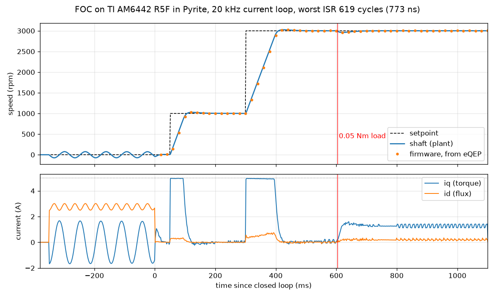
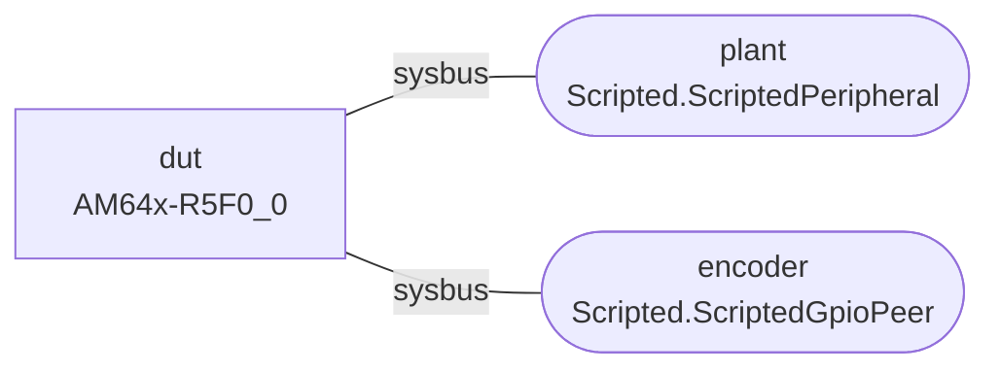
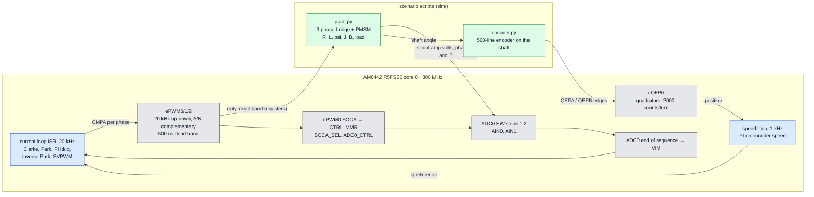

# foc-motor-am6442



Field-oriented control of a three-phase PMSM on a real-time core of a TI Sitara **AM6442**
(R5FSS0 core 0, Arm Cortex-R5F, 800 MHz), built with TI's MCU+ SDK and tested on every commit in simulation with [Pyrite](https://simantic.com),
Simantic's firmware simulator. No board or motor is needed to build, run or test it.

- **The firmware** (`fw/foc.c`, NORTOS, TI driverlib): ePWM0/1/2 generate 20 kHz centre-aligned
  three-phase PWM from the 250 MHz ePWM clock, A/B complementary with 500 ns dead time; ePWM0 SOCA, routed through CTRL_MMR to ADC0,
  converts both phase shunts as two hardware-synchronised steps at the centre of the low-side
  window; ADC0's end-of-sequence interrupt runs the 20 kHz current loop (Clarke, Park, PI on id and
  iq, inverse Park, SVPWM); a 1 kHz speed loop closes on eQEP0, a 500-line encoder. At boot it
  calibrates the current-sense offsets and aligns the rotor to find the encoder zero.
- **The simulation** (`sim/`): the firmware binary runs unmodified on the simulated AM6442's R5FSS0 core 0.
  `plant.py` is a PMSM (R 0.2 Ohm, L 100 uH, 7 pole pairs, 24 V bus) that reads the ePWM compare
  registers and drives the ADC pins; `encoder.py` turns the shaft angle into eQEP A/B edges.
  The plant adds a 0.05 Nm load 200 ms after the shaft first reaches 2950 rpm.
- **The tests** (`tests/`): pytest runs the scenario against five motors and checks the drive's
  step response, load rejection, limits and timing against the plant's true shaft.

Speed steps 0 -> 1000 -> 3000 rpm, then a 0.05 Nm load. Before t = 0 the drive calibrates its
current sense and aligns the rotor (the ringing on the d axis). The orange dots are the firmware's
own speed, from eQEP; the blue line is the plant's true shaft. `tools/plot.py` regenerates it.

## The scenario

What runs, as `sim graph --scenario sim/motor.yaml` prints it: the chip with the two scripted
parts on its bus.



What happens every PWM period. Blue is the firmware's code, grey is the chip's hardware as
Pyrite models it, green is the scenario's scripts (the part an engineer replaces with their own
motor and sensors):



## What is yours and what is the tool's

The firmware, the motor model and the pass limits here are an example: a plausible 24 V
drive, a textbook PMSM and limits picked from its nominal run. On a real project they are the
engineer's: your firmware, your motor's parameters (or your own plant in `sim/plant.py`), and the
limits your spec and datasheets set (`MIN_DEAD_NS`, `IQ_LIMIT_A`, the settling and overshoot
bounds in `tests/test_drive.py`), signed off by you.

What the tool gives you is the runtime: your unmodified binary on the chip's real peripheral
models (ePWM with its dead-band unit, the ADC and its trigger routing, eQEP, the interrupt
controller), against that plant, on every commit, with the true shaft and the bridge's actual
register state to test against.

## Run it

```sh
./demo          # run the drive in sim and print its console
./demo test     # the regression tests, five motors, about 30 s
./demo plot     # draw docs/drive.png and open it
```

These use the committed `fw/foc.release.out`, so they need only `sim` and `uv`. To rebuild the firmware:

```sh
make -C fw PROFILE=release foc.release.out   # SDK and tools under ~/ti; run twice on a clean tree
sim run --scenario sim/motor.yaml --ascii --timeout 1.8
```

Needs TI MCU+ SDK for AM243x 12.01.00.33, TI Arm Clang 4.0.4 and SysConfig 1.27.

**Why the AM243x SDK.** The AM243x is the AM64x die without the A53 cluster: the R5F subsystems,
ePWM, eQEP, ADC0, interrupt numbers and TISCI device IDs are the same, and TI keeps both in one
driver tree (`soc/am64x_am243x`). This firmware is built with the AM243x SDK because its SysConfig
metadata works on macOS today; the AM64x SDK's SysConfig fails on its own examples here
(`meta-code does not indicate how to handle the ip instance type "cpsw"`). The binary runs on the
simulated AM6442 R5F. Rebuilding it from the AM64x SDK is an open item.

## Test it

```sh
pip install pytest && pytest tests -v     # SIM=<path> picks a sim binary, about 30 s
```

Every test runs against five motors with the same firmware. The gains are tuned for `nominal`;
the others catch a drive that only works on the motor it was tuned on.

| Motor | Change |
| --- | --- |
| `nominal` | R 0.2 Ohm, L 100 uH, J 1e-4 kg m^2, 24 V bus |
| `hot_winding_R+50%` | R 0.3 Ohm |
| `L+50%` | L 150 uH |
| `heavy_load_J_x2` | J 2e-4 kg m^2 |
| `bus_sag_20V` | 20 V bus (the firmware still assumes 24 V) |

| Test | Checks (on the plant's true shaft unless noted) |
| --- | --- |
| `test_boots_and_reports_pass` | the firmware's own verdict |
| `test_current_sense_offsets_are_midscale` | ADC offset calibration |
| `test_bridge_has_dead_time` | every phase's dead-band unit is on with at least `MIN_DEAD_NS` (your gate driver's minimum), read from the ePWM registers |
| `test_encoder_alignment_is_field_oriented` | under load the current vector is within 15 deg of the q axis (a wrong encoder zero fails this) |
| `test_rise_time_0_to_1000_rpm` | 10-90% within 25% of the current-limited minimum J dw / (Kt Imax) |
| `test_overshoot_1000_rpm`, `test_overshoot_3000_rpm` | under 10% and 5% (integrator windup fails this) |
| `test_settles_at_1000_rpm`, `test_settles_at_3000_rpm` | within 2% after 120 ms and 250 ms |
| `test_load_step_dip`, `test_load_step_recovery` | the 0.05 Nm load costs under 5% and is recovered within 80 ms |
| `test_load_torque_is_carried_by_iq` | iq settles at load / Kt |
| `test_current_limit_is_respected` | iq never exceeds the 5 A limit |
| `test_firmware_speed_matches_the_shaft` | the firmware's eQEP speed against the true speed |
| `test_isr_fits_the_pwm_period` | current loop under 10% of the 50 us period (simulated cycle count) |

Known: with `heavy_load_J_x2` the fixed speed gains settle the 1000 rpm step in ~280 ms instead
of ~150 ms, so two tests are strict expected failures there. Gain scheduling would make them pass,
and pytest would then flag the marker for removal.

The tests caught one real bug while they were written: the speed PI wound up its integrator
during current-limited steps (17% overshoot). `pi_run` now integrates only when unsaturated.

## CI

`.github/workflows/ci.yml` installs the released `sim` and runs the drive and the tests on every
push and pull request, against the committed firmware (TI's toolchain is not installed in CI).
It needs repository secrets `SIM_EMAIL` and `SIM_API_KEY`.

## Limits

- Simulated only: not yet run on an AM64x EVM and motor. Cycle counts are the simulator's
  estimate, not a silicon measurement.
- The plant averages switching (no ripple) and the sensors are ideal; dead time enters as the
  average voltage it costs each phase, read from the dead-band registers.
- Needs a `sim` build with the AM64x ePWM peek (pyrite PR #3598); the released 0.10.2
  does not have it.
- Not yet the A53 side (Linux) or the PRU-ICSSG (encoder and sigma-delta interfaces).
